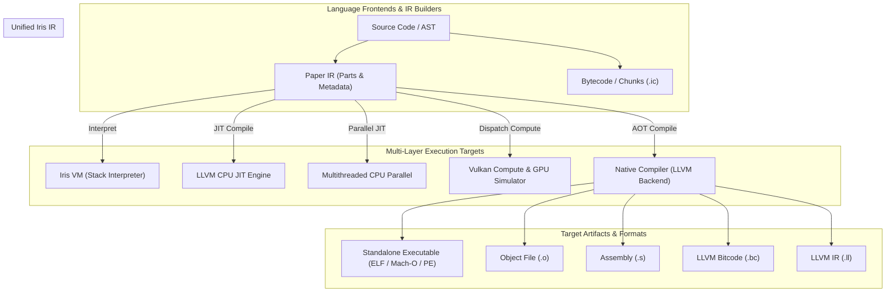

# Iris Runtime: Multi-Layer Execution Engine & Compiler

**Iris** is a multi-tier runtime engine, ahead-of-time (AOT) compiler, and virtual machine written in Rust. Designed around a "write once, run anywhere" philosophy, Iris enables language designers and systems developers to target diverse execution backends—from bytecode interpreters to CPU JIT, native binary generation, and hardware GPU compute—using a unified intermediate representation (IR).

<p align="center">
  
</p>

---

## Architecture Overview

Iris bridges high-level language front-ends and heterogeneous hardware execution models through an intermediate construct known as **Paper** composed of modular execution **Parts**.



---

## Execution Layers in Detail

| Execution Target | Backend                 | Description                                                                                           |
| :--------------- | :---------------------- | :---------------------------------------------------------------------------------------------------- |
| **`vm`**         | Stack-based Interpreter | Fast startup, portable execution, deep runtime inspection.                                            |
| **`cpu`**        | LLVM JIT                | Compiles Iris Papers directly to host machine code on the fly for heavy arithmetic workloads.         |
| **`gpu`**        | MLIR > Vulkan           | Dispatches compute workloads across 3D grids and thread blocks using MLIR & Vulkan compute pipelines. |
| **`native`**     | LLVM AOT                | Emits standalone executables.                                                                         |

---

## Installation & Prerequisites

### Requirements

- **Rust** (Edition 2021, MSRV 1.70+)
- **LLVM** (v22 or compatible with `llvm-sys` / `inkwell`)
- **Vulkan SDK** (Optional, required for hardware GPU compute dispatch via `ash`)
- Standard C compiler / linker (`cc`, `clang`, or `gcc`) for linking native executables

### Building from Source

```bash
git clone https://github.com/Iris-proj/iris-runtime.git
cd iris-runtime
cargo build --release
```

The compiled CLI binary will be available at `target/release/iris`.

---

## Command Line Interface (CLI)

```bash
Iris VM & Compiler CLI
Usage: iris <command> [<args>]

Commands:
  build    compile Iris program to native targets
  run      execute Iris program
```

### Running Programs

Execute an Iris program on any target using `iris run`:

```py
# Run on the default Native JIT / AOT engine
iris run app.paper --target native -O 3

# Run inside the Iris Virtual Machine interpreter
iris run app.paper --target vm

# Run with LLVM CPU JIT
iris run app.paper --target cpu -O 2

# Execute on GPU via Vulkan compute
iris run app.paper --target gpu

# Run a compiled bytecode file (.ic)
iris run bytecode.ic
```

### Compiling Ahead-of-Time (AOT)

Generate standalone executables, object files, or LLVM IR using `iris build`:

```py
# Build standalone binary executable
iris build app.paper -o my_app --emit exe -O 3

# Generate relocatable object file
iris build app.paper -o my_app.o --emit obj

# Emit target assembly or LLVM IR
iris build app.paper --emit asm -o my_app.s
iris build app.paper --emit ll  -o my_app.ll

# Cross-compilation target specification
iris build app.paper --target-triple x86_64-unknown-linux-gnu --cpu skylake -O 3
```

---

## Rust API Usage

You can use Iris directly as a Rust library in your custom language runtime or compiler backend.

```rust
use iris::builder::paper::{Paper, ExecutionTarget};
use iris::builder::part::{Part, Size, IntegerCalculateType};
use iris::vm::engine::IrisEngine;

fn main() -> Result<(), Box<dyn std::error::Error>> {
    let paper = Paper::new("SimpleAdd", vec![
        Part::Integer(Size::S32, 25, false),
        Part::Integer(Size::S32, 17, false),
        Part::CalculateInteger(Size::S32, IntegerCalculateType::Add),
        Part::ReturnInteger,
    ]);

    let mut vm = IrisEngine::new();
    let vm_res = paper.run_vm(&mut vm)?;
    println!("Result from VM: {:?}", vm_res);

    paper.build_native_executable("target/simple_add", inkwell::OptimizationLevel::Aggressive)?;

    Ok(())
}
```

---

## Project Structure

```py
iris-vm/
├── Cargo.toml               # Package dependencies (inkwell, ash, serde, bincode, etc.)
├── src/
│   ├── lib.rs               # Library root export (vm, data, builder)
│   ├── bin/
│   │   └── iris.rs          # CLI binary implementation (build and run commands)
│   ├── builder/             # IR building, LLVM codegen, and Paper constructs
│   │   ├── compiler.rs      # Runtime function compiler (LLVM JIT)
│   │   ├── native.rs        # AOT native compiler & linkers
│   │   ├── paper.rs         # Paper IR definition & execution targets
│   │   ├── part.rs          # Atomic operations, instructions, structs
│   │   └── mlir_compiler.rs # Optional MLIR backend integration
│   ├── vm/                  # Virtual machine core
│   │   ├── engine.rs        # IrisEngine stack interpreter & call frames
│   │   ├── opcode.rs        # Complete opcode definition set
│   │   ├── chunk.rs         # Bytecode chunks and constant pool
│   │   ├── object.rs        # Classes, instances, and closures
│   │   ├── value.rs         # Dynamic Value enum representation
│   │   ├── gpu.rs           # GPU device abstractions & thread scheduling
│   │   └── vulkan.rs        # Ash Vulkan compute shader context
│   └── data/                # Persistence & serialization
│       ├── bytecode.rs      # Bincode encoding/decoding for functions
│       └── archive.rs       # Zip archive packager for Iris files
└── tests/                   # Integration, performance, and unit test suites
```

---

## Contributing

Contributions are welcome! Please feel free to open issues or submit pull requests.

1. Fork the repository
2. Create your feature branch (`git checkout -b feature/amazing-feature`)
3. Commit your changes (`git commit -m 'Add some amazing feature'`)
4. Push to the branch (`git push origin feature/amazing-feature`)
5. Open a Pull Request

---

## License

Iris Runtime is licensed under the GPL-3.0 License. See the [LICENSE](LICENSE) file for details.
